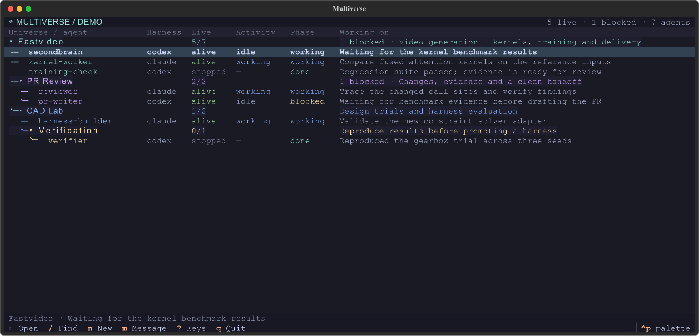

# Multiverse 2.0 — first working slice

Local universes, short prompts, ordinary shell tools. Models decide how to coordinate; a small CLI handles file integrity and terminal identity. The dashboard uses Textual; the orchestration core uses the Python standard library. This is a standalone implementation alongside V1, with no imports from it, no daemon and no MCP server.

The base bootstrap is under 200 words, plus agent identity and paths. It supplements the harness's normal prompt. Skills, workflows and commands stay on disk until needed. This follows [Pi's minimal, extensible approach](https://github.com/earendil-works/pi/tree/main/packages/coding-agent); it doesn't require using Pi.

## Try it

Requires Python 3.11+, tmux, and an installed/configured Codex, Claude Code or Pi CLI. Codex is the default. CLI flags were checked against Codex 0.154.0 and Claude Code 2.1.231; the optional Pi integration is tested against 0.84.3. macOS and Linux are the intended platforms; this version was exercised on macOS with tmux 3.6a.

From the repository root:

```sh
uv sync
.venv/bin/python examples/tui_demo.py
```

The checkout-only example in `examples/tui_demo.py` has a project universe, PR review and CAD subverses, nested verification, and sample agents. Its actions operate entirely in memory; it needs no tmux, model account or existing universe. The checkout launcher automatically uses `.venv` after setup.

For real work, run `mv2` (or `./bin/mv2` from the checkout) without a command to
open the dashboard. It reuses the current or nearest parent universe; if none
exists, it initializes `.multiverse/` in the current directory with the bundled
base template. This does not launch any agents. Explicit `-u` and
`MV2_UNIVERSE` selections are respected and must already exist. Commands such as
`mv2 tui`, `mv2 init` and `mv2 --help` retain their existing behavior.

For example:

```sh
./bin/mv2 init /path/to/project
./bin/mv2 -u /path/to/project spawn --name worker --task 'Inspect this project and summarize its architecture.'
./bin/mv2 -u /path/to/project spawn --name reviewer --harness claude --task 'Review the current diff.'
./bin/mv2 -u /path/to/project tui
```

Or install with `pip install .` to put `mv2` on PATH, including its Textual dependency. No agent is launched just by opening the dashboard or initializing a universe.

```sh
mv2 -u /path/to/project subverse pr-review
mv2 -u /path/to/project/.multiverse/subverses/pr-review spawn --name reviewer --task 'Review the current branch using the review workflow.'
mv2 -u /path/to/project list --recursive
mv2 -u /path/to/project/.multiverse/subverses/pr-review send reviewer --text 'Focus on correctness and regression risks.'
```

`-u` selects a universe. Inside a spawned agent it defaults to `$MV2_UNIVERSE`; outside an agent it searches the current directory and ancestors. Cross-universe commands use an explicit `-u`. Agent references accept a full UUID, an unambiguous UUID prefix, or a unique name. Ambiguity is an error.

## Individual tools

Each action lives in `src/multiverse/tools/` with its own argument definitions
and importable `run` function. `mv2` remains a small compatibility dispatcher;
the TUI backend calls the same tool functions directly. Shared file, terminal
identity and launch mechanics remain in `store.py`, `tmux.py`, `agents.py` and
`runner.py`.

With the package installed, run a tool without the dispatcher:

```sh
python -m multiverse.tools.list_agents -u /path/to/project --recursive --json
python -m multiverse.tools.spawn -u /path/to/project --name worker --task 'Review the code.'
python -m multiverse.tools.inspect -u /path/to/project worker
```

For a checkout, use its Python environment with `PYTHONPATH=src`.
Run modules with `python -m`, rather than executing their files by path.
Tool names match CLI commands except `list` is `list_agents`, and hyphens become
underscores (`session_bind`, `runtime_update`). Every tool supports `--help`.
Python callers use, for example,
`spawn.run(root, name="worker", task="Review the code.")` or
`list_agents.run(root, recursive=True, json=True)`; results are returned and
errors raised, while shell entry points format output and exit codes.

`send` saves the durable record and attempts native delivery through the common
adapter protocol. `ask` and `get-usage` use the same tools from CLI and
backend. Unsupported operations are explicit. The Claude bridge's mod is the one
place that presses Enter: in the agent's own tmux pane, to submit a message it has
typed into an idle session (see [harness adapters](docs/harness-adapters.md)).

## Files and ownership

```text
project/.multiverse/
  universe.json                 # ID, name, workspace and template provenance
  bootstrap.md                  # short automatic instructions
  harnesses/codex/              # declarative source adapter reference and preferences
  harnesses/claude/             # declarative source adapter reference and preferences
  harnesses/pi/                 # declarative reference; optional source-owned bridge
  skills/coordination/          # entry.json metadata + SKILL.md
  commands/help/                # entry.json metadata + prompt.md
  workflows/review/             # entry.json metadata + prompt.md
  views/default.json            # local dashboard title, accent and columns
  state/                        # local, ignored by Git
    agents/<uuid>/
      properties.json           # identity, task, reported phase and summary
      runtime.json              # launch generation, host, pane, reported status
      inbox.jsonl               # append-only messages with IDs and reply references
      inbox.cursor              # acknowledged byte offset
      session.jsonl             # native Pi conversation
      launches/<uuid>/          # exact bootstrap, task and argv for each launch
  subverses/pr-review/           # the same structure, recursively
  trash/<stamp>-<name>/          # removed agents and subverses, ignored by Git
```

Everything belongs to the universe, including its live state. Definitions and runtime have separate directories so a clean template install can exclude old conversations and processes. JSON describes current state, JSONL records messages, and Markdown holds prompts. Lock files and temporary files are implementation details.

`init --template NAME` looks for `~/.multiverse/templates/NAME`, then a bundled template; an explicit directory also works. `subverse NAME --template PATH` uses the same installer. It copies definitions, generates fresh IDs recursively, and starts with empty state. It does not silently update existing universes. Templates are trusted local files and may contain executable adapters; symlinks are rejected.

Subverses inherit the parent's workspace **at creation**, using a relative path. They receive their own clean definitions and IDs, with no implicit ongoing prompt inheritance. `subverse NAME --workspace /path/to/worktree` can target a worktree. The universe remains in the parent tree when that worktree is removed; `doctor` reports the missing workspace. A universe can have a manager agent, but none is mandatory or auto-created.

### Moving and removing

The dashboard renders the directory tree, so rearranging it is a directory move:

```sh
mv2 move worker cad-lab/verification        # agent into a subverse of this universe
mv2 move --subverse cad-lab ../other/.multiverse
mv2 remove worker                            # into this universe's trash/
mv2 remove --subverse pr-review
mv2 trash                                    # list; --empty deletes permanently
```

Destinations are universe directories or subverse paths such as `cad-lab/verification`, never an ancestor found by searching upward. Everything moved or removed must be stopped, including every agent inside a subverse: a running agent has its directory in its environment, system prompt and tmux tags. An agent keeps its inbox, launches and native session binding; only its universe ID changes, and the destination must configure its harness. A moved subverse keeps its IDs, and relative workspaces are recomputed for the new depth. Removal writes a `.removed.json` record with the original path; moving the entry back restores it. Native harness histories outside `.multiverse` are never touched. Top-level universes cannot be moved or removed with these commands.

## The Textual dashboard

The dashboard is one compact hierarchy. The root universe and every nested subverse appear as colored, collapsible group rows, with their agents underneath. Vertical guides and rounded branch ends connect each group to its children; the lines follow the visible tree when folding or searching. All descendants are loaded together; there is no sidebar or local/all toggle. A skill supplies instructions to an agent; a subverse gives a group its own configuration, workflows, agent state and display identity. It behaves like a folder in the UI.

The [r/unixporn Catppuccin setups](https://www.reddit.com/r/unixporn/comments/1fao619/) informed the muted palette. Group accents and indentation distinguish subverses without separate navigation panels.



One-line headers and footer hints leave the terminal for agents. There are no action buttons. Search opens with `/`, includes folded descendants, and keeps matching ancestors visible. Escape clears it and restores the existing folds. `v` opens full details. At smaller widths, secondary columns disappear; the demo's entire hierarchy fits at 60×20 with the inspector closed. `NO_COLOR` is respected.

Press `p` to open the inspector: current work, harness/model, status, reported phase, and a live pane capture. It opens and closes only with `p` (Escape also closes it); hovering or selecting a row never opens it. While open it follows the selected row. The inspector sits to the right at 120 columns and wider, or becomes a short drawer below the list. Groups show counts and recent work instead of a terminal. Captures refresh with the dashboard (normally every 1.5 seconds), retain your scroll position when reading older output, and discard results from a previous agent or launch.

`n` inserts a draft row in the selected group, following the original Multiverse monitor's inline creation pattern. Type over the suggested name; Tab cycles through name, harness, and optional model. New agents start idle with no initial prompt; message them with `m` once they are running. Harness opens an inline selector populated from that group's `harnesses/*/harness.json`: arrows choose, Enter confirms, or click an option. Codex is preferred, then Claude, then the first configured adapter. It is not a free-text field. Enter in a text field creates the agent; Ctrl+Enter submits from any field, and Escape discards. Creation failures retain the draft for correction. No agent starts before submission.

`g` inserts a subverse draft row the same way, asking only for a name. It inherits the parent's workspace and uses the base template; `mv2 subverse --template --workspace` covers other choices. Messages still use a compact form.

`x` marks the selected agent or subverse for moving. Arrow keys, folding and clicks keep working; Enter or `x` on a group moves it there, and on an agent it moves into that agent's universe. Esc cancels, and a refused destination keeps the move pending so another can be chosen. `d` deletes to the trash after a confirmation that names what goes, including the agent count for a subverse. Both refuse running agents and the universe currently shown as the top; they call the same tools as `mv2 move` and `mv2 remove`.

Filesystem and tmux work run outside the UI event loop. Stable agent keys preserve selection across refreshes. New agents and subverses belong to the selected group; selecting an agent targets its group. Drafts and dialogs capture the intended universe and recipient before submitting an action. Rendering and I/O are separated in `tui.py` and `dashboard.py` for testing.

### Agent identity

The TUI reads `properties.json` to discover agents and their reported work. It reconciles `runtime.json` with `tmux list-panes` to observe whether each launch is alive. Each pane carries three tags: universe ID, agent ID and launch ID. A readable window/session name is only a label. Renaming it does not change identity; a reused pane ID cannot impersonate an old launch. Unknown or inaccessible state is shown as unknown.

`LIVE` comes from tmux, `STATUS` (`working`, `waiting` or `idle`) comes from the harness, and `PHASE`/`SUMMARY` come from the model. A `waiting` agent needs you: a permission prompt, a question or a plan approval is open. Waiting agents are marked with an orange `●` and status badge, and groups and the header count them (`2 waiting`) alongside blocked agents. A live agent can report `done`; a stopped agent's last task can still say `working`. The dashboard preserves that distinction. It never fabricates progress by reading terminal text.

The dashboard is a reader and command client. Quit it and agents continue. The default tmux server is named `multiverse-v2`, separate from existing sessions; `MV2_TMUX_SOCKET` can select an explicit socket. Attach/inspect/stop verify pane ownership first. `stop` terminates the pane and its running work.

| Key | Action |
| --- | --- |
| ↑/↓ or k/j | Select a row |
| ←/h, →/l | Fold / parent; expand / first child |
| Enter / Space | Enter attaches to a live agent; either key folds a group |
| /, Escape | Search all groups; clear search |
| n / m | Spawn in selected group / message selected agent |
| g | Create a subverse inside the selected group |
| s / r | Stop after confirmation / resume |
| v / p | Full details / show or hide inspector |
| ? / q | Keyboard help / quit dashboard |
| F5 / Ctrl-p | Refresh / command palette |
| Tab / Shift-Tab | Move between inline draft fields or form fields |
| ↑/↓ in the harness field | Choose a configured harness |
| Enter / Escape in a draft | Confirm harness or create / discard the new agent |
| Escape / Ctrl-Enter | Cancel / submit a form |

Mouse: click a group to fold it, click an agent to select it, or double-click to attach. The footer key hints are clickable, including form submission and cancellation.

Detach from an attached agent with tmux's usual binding (normally Ctrl-b d) to return to the dashboard that opened it. This also works when the dashboard runs inside tmux: the host terminal opens the agent client and reattaches to the exact dashboard pane when that client exits. The dashboard's selection/state and agent process remain alive. On the dashboard itself, detach works normally. Custom prefixes and bindings are preserved; uppercase L remains tmux's stock last-session action. Each universe can customize `views/default.json`:

```json
{
  "title": "PR Review",
  "accent": "#cba6f7",
  "columns": ["name", "live", "phase", "summary"]
}
```

The title and accent style its group row and agents in the parent hierarchy. The base template uses `"accent": "auto"` to assign subverse colors consistently from their IDs; an explicit hex color overrides it. The root view chooses the shared table columns; opening the TUI directly at a subverse uses that subverse's column configuration. Arbitrary view plugins and dashboard links remain follow-up work.

## Messages, commands and prompts

`send` durably saves each message, then submits its actual text with `--delivery steer` or `--delivery follow-up`. Core records pending/accepted/failed/unknown submission states, native receipts, and per-ID acknowledgements. `inbox` shows unread manual messages; `inbox --all` shows all history and delivery evidence. Use `--delivery inbox-only` (or `--queue-only`) for manual delivery. Acknowledge native messages with `ack --message-id UUID`; legacy cursor ack covers manual messages only. `deliver --message-id UUID --retry` retries definite failures, never uncertain or accepted submissions. `--check` reconciles native receipts where supported. Acceptance is not reading or an answer; `--reply-to` correlates replies. See [the adapter contract](docs/harness-adapters.md).

`catalog` reads only capability metadata. `command review` prints the matching prompt without executing it. `/multiverse list` and `/multiverse review ...` are prompt conventions. Native CLIs may intercept slash commands before the model sees them; send ordinary text such as `Please run /multiverse list`, or use `mv2 catalog` in a shell. Names must match exactly; qualify an ambiguous name as `workflows/review`. Workflow control flow remains prose interpreted by the model.

There are no added model tools. Agents use `$MV2_CLI` through their ordinary shell tool. Pi's bundled `extension.ts` is **optional and disabled by default**. Setting `"inbox_bridge": true` in its schema-2 `settings` enables native steering or follow-up delivery, lifecycle observations and a native `/multiverse` command. Stable message IDs must appear in the native transcript before automatic acknowledgment. Codex also supports `"inbox_bridge": true`: core starts or reuses the shared native daemon for its Codex home and attaches the native TUI to the exact session on it. `mv2 send` then sends normal after-turn messages or urgent safe-boundary steering to the exact bound thread. See the adapter guide for native resume permission constraints. These bridges are opt-in; compatibility launches report the missing required delivery capabilities explicitly.

## Harness definitions

Spawn accepts an optional initial prompt (`--prompt`, with `--task` retained as an alias). Spawn/resume return an exact session handle; `list` reads current identity and core process state. The adapter takes `resume(session, context)`, keeping the exact saved conversation separate from launch options. `ask` and `get-usage` are explicit operations. `ask` reports unavailable for bundled providers; `get-usage` measures Claude sessions from their transcripts and reports unavailable for the others.

Built-in implementations live in separate source packages under `src/multiverse/harnesses/`. New universes keep declarative schema-2 adapter references and preferences in `harnesses/NAME/harness.json`. See [the adapter contract, capability matrix and extension guide](docs/harness-adapters.md). Custom local command harnesses can still use schema 1 without registering Python code.

A legacy/custom manifest declares `schema: 1`, `spawn` and optional `resume` argv arrays, optional `model_args`, `bootstrap` text, `unset_env` names and a docs URL. Arguments are passed directly to the process, never through a shell. Model flags are inserted before a `--` terminator when present, so prompts beginning with a hyphen remain literal. Available substitutions:

| Value | Meaning |
| --- | --- |
| `{name}`, `{agent_id}`, `{workspace}` | Agent name, UUID and working directory |
| `{agent_dir}`, `{harness_dir}` | Runtime files and local adapter definition |
| `{task}`, `{task_file}` | Initial prompt text or its saved file |
| `{bootstrap}`, `{bootstrap_file}` | Short bootstrap text or its saved file |
| `{bootstrap_json}` | Quoted bootstrap string, also suitable as a TOML string value |
| `{model}` | Explicit model override; omitted flags use the native default |
| `{session_file}`, `{session_id}` | File-based session path or recorded native UUID |

`session` defaults to `file` (Pi). `assigned` gives the harness the agent UUID at launch (Claude). `reported` requires the native UUID to be recorded through `mv2 session-bind` (Codex). Claude resumes that assigned UUID. Codex's startup prompt asks it to register `$CODEX_THREAD_ID` before working; resume fails clearly if this has not happened, rather than choosing another agent's session. See the [Codex adapter](src/multiverse/templates/base/harnesses/codex/README.md) and [Claude adapter](src/multiverse/templates/base/harnesses/claude/README.md) for native permission prompts, session recovery and integration limits. Status remains `unknown` unless reported (Claude agents with the bridge report working, waiting or idle); liveness still comes from tagged tmux panes.

Existing schema-1 definitions and assets remain authoritative and are never rewritten on package update. Opting into schema 2 is explicit: preserve every local model, argument, permission and workspace preference; keep schema 1 for behavior that cannot be represented. No live-universe migration is automatic.

## Verification and next slices

```sh
.venv/bin/python -m unittest discover -s tests -v
./bin/mv2 -u /path/to/project doctor
```

The Textual tests use `App.run_test()` and Pilot to exercise real widgets, mouse clicks, keystrokes, forms, cancellation, recursive folding, search through folded groups, correctly scoped creation, stable selection, failure reporting, stale captures, inline draft preservation, slow refreshes, and resizing down to 60×20. They need no terminal, sockets or model:

```sh
.venv/bin/python -m unittest discover -s tests -p test_tui.py -v
.venv/bin/python scripts/render_tui.py
```

The renderer exports actual SVG screens to `/tmp/multiverse-previews` for visual review, including the unified hierarchy, live inspector, narrow layouts and inline creation. Additional tests cover concurrent inbox writers, interrupted records, recursive installs, ambiguous commands, real tmux launch/rename/stop/resume and pane ownership, Textual attach/detach/exit, Codex/Claude argv and exact resume with fake executables, session registration guards, and real Pi and Codex native delivery/resume with their bridges and local scripted providers. They use temporary universes and isolated tmux sockets, with no network or model spend. Authenticated Codex/Claude model turns are not exercised. Native timing checks skip when their harness or tmux binaries are absent. A sandbox that denies Unix sockets must allow the terminal integration tests explicitly.

`doctor` is a basic local diagnostic, not the proposed TVA evaluator. The next slices are optional native delivery integrations, richer views and artifact links, explicit template upgrades/inheritance, discovery across unrelated project roots, and reusable workflow/TVA evaluation templates. There is no scheduler, remote agent transport, automatic manager hierarchy, background ask primitive, or urgent mid-turn delivery in this slice.

## Development checkout

Run `uv sync --locked`, then `. scripts/dev-env.sh` in the main checkout to use
the local `.multiverse` and `.run/tmux.sock`. Launch `mv2 tui`. Worktrees share Git
history; runtime state and evidence are ignored. See `.multiverse/DEVELOPMENT.md`
for this machine’s active agents and migration conventions.
