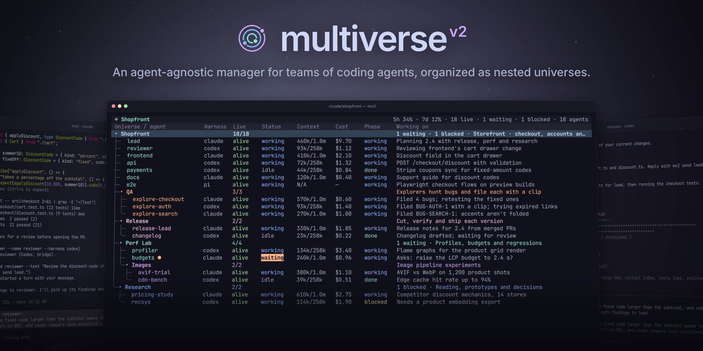

# Multiverse

<p align="center">
  
</p>

<p align="center">
  <a href="https://github.com/GoatedGoaterestGoat/multiverse/stargazers"></a>
  <a href="LICENSE"></a>
  <a href="docs/reference/compatibility.md#checked-harness-versions"></a>
  <a href="docs/reference/compatibility.md#checked-harness-versions"></a>
</p>

**A harness-agnostic, extensible manager for agent teams.**

Multiverse (`mv2`) runs Claude Code, Codex and Pi side by side in tmux and shows them in one terminal dashboard. Open any agent's terminal from the dashboard to work with it, and return when you're done.

- **Universes and subverses.** Each project gets a `.multiverse/` folder holding its agents' instructions, harness settings and records. Subverses are universes nested inside it, so separate teams keep their own setup.
- **Agents coordinate through the CLI.** An agent uses the same `mv2` command you do to start helpers, message them and report progress. There are no extra model tools, no MCP server and no mv2 daemon.
- **Messages that arrive.** Every message is saved before delivery, and mv2 delivers through each harness's own interface instead of typing into its terminal, so it knows whether a message was accepted.
- **Files you can edit.** The prompts agents receive, the harness settings and each universe's dashboard view are Markdown and JSON files in `.multiverse/`.
- **Plugins.** Plugins can add dashboard columns and panels, commands, and options for how agents launch. Tree compaction and the remote control are built as plugins.

## Demo

https://github.com/user-attachments/assets/24084193-fc3d-48a6-a9a6-c3e7415220a5

## Status

mv2 is in early development. It runs Claude Code, Codex and Pi on Linux and macOS, and its commands, files and plugin API can still change between versions.

## Install

You need Linux or macOS, Python 3.11 or newer, tmux, and at least one of [Claude Code](https://docs.anthropic.com/en/docs/claude-code), [Codex](https://github.com/openai/codex) or [Pi](https://github.com/earendil-works/pi), installed and logged in.

```sh
git clone https://github.com/GoatedGoaterestGoat/multiverse.git
cd multiverse
uv sync
./bin/mv2 --help        # or: pip install . to put mv2 on your PATH
```

## Quick start

```sh
cd ~/my-project
mv2
```

In the dashboard, press `n` to start an agent, `Enter` to open its terminal and give it a task, and `Ctrl-b d` to return while it works. [Getting started](docs/getting-started.md) walks through the first session. To try the dashboard without tmux or a model account, run `.venv/bin/python examples/tui_demo.py`.

## Documentation

| | |
| --- | --- |
| Start here | [Getting started](docs/getting-started.md) · [Concepts](docs/concepts.md) |
| Using mv2 | [Dashboard](docs/use/dashboard.md) · [Working with agents](docs/use/agents.md) · [Subverses](docs/use/subverses.md) · [Harnesses](docs/use/harnesses.md) · [Plugins](docs/use/plugins.md) · [Updating](docs/use/updating.md) · [Troubleshooting](docs/use/troubleshooting.md) |
| Commands agents use | [Overview](docs/cli/README.md) · [Agents](docs/cli/agents.md) · [Messaging](docs/cli/messaging.md) · [Universes](docs/cli/universes.md) · [Prompts](docs/cli/prompts.md) · [Reference](docs/cli/reference.md) |
| Reference | [Dashboard](docs/reference/dashboard.md) · [Files](docs/reference/files.md) · [Environment](docs/reference/environment.md) · [Compatibility](docs/reference/compatibility.md) |
| Developing mv2 | [Contributing](docs/develop/contributing.md) · [Architecture](docs/develop/architecture.md) · [Making plugins](docs/develop/plugins.md) · [Harness adapters](docs/develop/harness-adapters.md) · [Templates](docs/develop/templates.md) · [Testing](docs/develop/testing.md) |

## Contributing

Start with [contributing](docs/develop/contributing.md) and the [architecture](docs/develop/architecture.md) notes. Coding agents working on this repository should follow [AGENTS.md](AGENTS.md).

## License

mv2 is released under the [MIT license](LICENSE).
