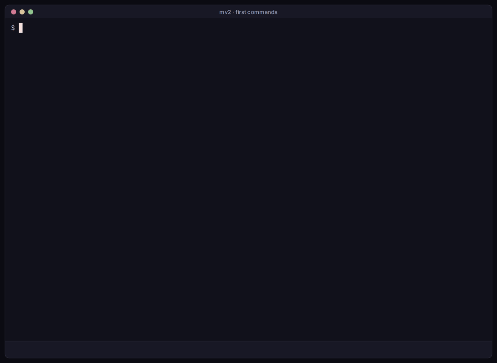

# Commands

Your agents use mv2 through these commands. Each agent runs them from its own shell as `"$MV2_CLI"`. With them, an agent starts helpers, messages other agents, reads its inbox and reports progress. You can run them too, as `mv2`, in scripts or when a shell is quicker than the dashboard.

## How agents learn them

At launch, every agent gets a short note from mv2, the universe's `bootstrap.md`. The note lists the few commands the agent needs most and says where to find more. When the agent needs to coordinate other agents, it loads the `coordination` skill.

Neither you nor the agent has to read these pages for that to work. They are for you, to learn what your agents can do and to script mv2 yourself.

## At a glance

| Command | Does |
| --- | --- |
| `mv2 spawn --name NAME --task '...'` | Start an agent |
| `mv2 list` | List the agents here, their state and what they last reported |
| `mv2 inspect NAME` | Show one agent's key facts and recent terminal |
| `mv2 kill NAME`, `mv2 resume NAME` | Stop an agent, or continue its conversation |
| `mv2 send NAME --text '...'` | Message an agent |
| `mv2 inbox` | Read this agent's unread inbox messages |
| `mv2 report --phase working --summary '...'` | Say what this agent is doing |
| `mv2 subverse NAME`, `mv2 catalog`, `mv2 command NAME` | Make a subverse, list the prompts, or load one |
| `mv2 doctor` | Check a universe for problems |

Every command takes `--help`, and most take `--json` for scripts.

## Pages

- [Agents](agents.md): start, find, watch, stop, resume, move and remove agents.
- [Messaging](messaging.md): send messages, choose how they're delivered, read inboxes, report progress.
- [Universes](universes.md): universes and subverses, `-u`, templates, catalogs and `doctor`.
- [Prompts](prompts.md): change what your agents are told.
- [Reference](reference.md): every command and flag, generated from mv2 itself.
