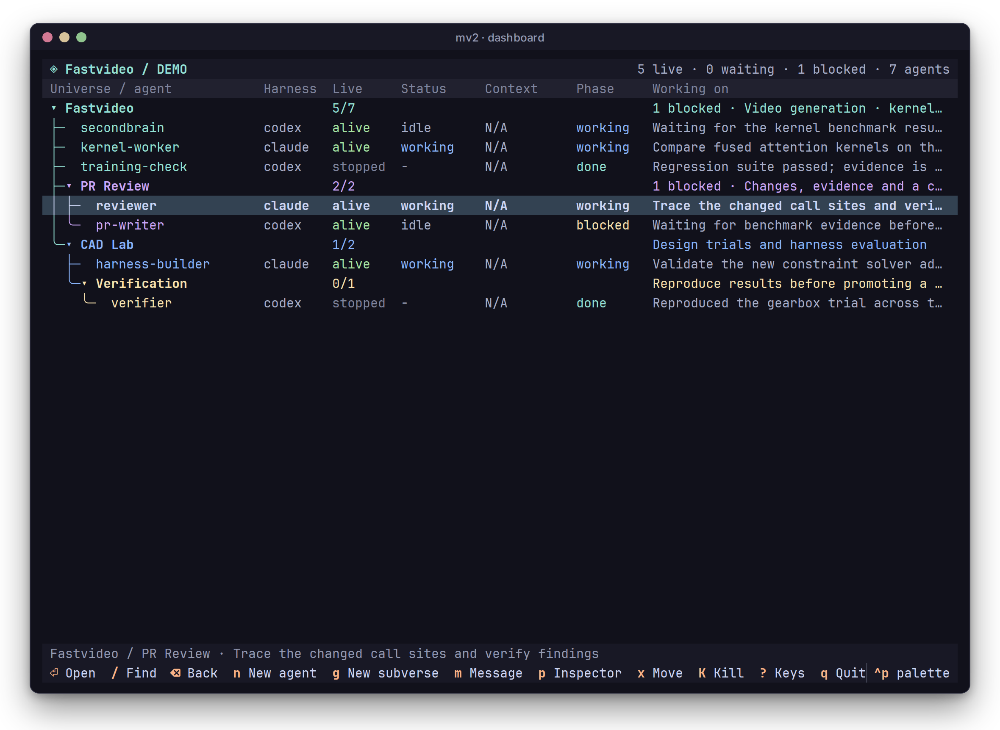

# Dashboard reference

Every dashboard key, column and view setting is listed here. For a quick start, see the [dashboard](../use/dashboard.md) page.

```sh
mv2              # the current universe, created if there is none
mv2 tui          # the current universe
mv2 -u .multiverse/subverses/review tui
```



## Layout

- **The list** is one tree. The universe and each subverse are folders, with their agents underneath. Folders fold and unfold.
- **The header** counts live agents, agents waiting for you (an orange `●` marks them) and focused agents (a `◉` marks them). For Claude agents with a live connection, it also shows your account's rate-limit windows, such as `5h 34% · 7d 12%`. `mv2 changed: reopen` appears when mv2's own code changed on disk after the dashboard started (see [troubleshooting](../use/troubleshooting.md#the-dashboard-says-mv2-changed)).
- **The inspector** (`p`) shows the selected agent's work, harness and model, state, and a live view of its terminal. When something is wrong, the reason comes right after the agent's name: an unusable record (with its file), a failed launch, a lost connection, the reason a launch fell back to plain, or a plugin the launch left out. For a folder, it shows counts and recent work. It sits on the right in wide terminals and below the list in narrow ones. `v` lists the same launch mode and fallback reason.
- **The bottom line** shows key hints and the result of your last action. The hints are clickable.

In a narrow terminal, the optional columns are hidden first. The whole tree fits in 60×20. The dashboard respects `NO_COLOR`.

## Columns

| Column | Shows |
| --- | --- |
| `name` | The agent's name (always shown) |
| `live` | `alive`, `ending`, `stopped`, `dormant`, `starting` (a new agent still being prepared) or `unknown` |
| `status` | `working`, `waiting`, `idle` or `disconnected`, from the harness over a live connection |
| `context` | The latest request's size against the model's window, such as `82k/200k`. It turns yellow at 70% and red at 90% |
| `cost` | The session's cost so far (off by default) |
| `phase`, `summary` | What the agent last reported with `mv2 report` |
| `focus` | How long the agent's focus lasts: the time left, `turn` or `on` (off by default) |
| `harness` | The harness the agent runs |
| `id`, `universe`, `task`, `updated_at` | Optional extra columns |

Choose columns in the universe's `views/default.json` (see [views](#views)). [Concepts](../concepts.md#agent-state) explains the state fields.

## Keys

| Key | Action |
| --- | --- |
| `↑`/`↓` or `k`/`j` | Select a row |
| `←`/`h`, `→`/`l` | Fold, or go to the parent; expand, or go to the first child |
| `Space` | Fold or expand the selected folder |
| `Enter` | Attach to a live agent; enter a subverse |
| `Backspace` | Return to the previous universe |
| `/`, `Esc` | Search every folder, including folded ones; clear the search |
| `n` | Create an agent in the selected folder |
| `g` | Create a subverse in the selected folder |
| `m` | Message the selected agent |
| `f` | Focus the selected agent, or unfocus it |
| `K` or `s` | Kill the selected agent, after confirming |
| `r` | Resume a stopped or dormant agent |
| `p` | Show or hide the inspector |
| `v` | Show full details of an agent or folder |
| `x` | Move the selected agent or subverse |
| `d` | Send the selected agent or subverse to the trash, after confirming |
| `P` | Open the selected universe's plugins: turn each on or off (choosing its access when it can work with less than it asks for), see what it adds and its access, and Configure it; see [plugins](../use/plugins.md) |
| `Tab` | Move between the list, a local view and its links |
| `F5` | Refresh now |
| `?` | Show all keys |
| `Ctrl-p` | Open the command palette, including plugins' actions |
| `q` | Quit. Agents keep running |

In forms, `Tab` and `Shift-Tab` move between fields, `Ctrl+Enter` submits and `Esc` cancels.

**Mouse:** click a folder to fold it, and double-click it to enter it. Click an agent to select it, and double-click it to attach. Click the breadcrumb to go back.

## Create agents and subverses

Press `n` to add a draft row in the selected folder. Type the name, then press `Tab` to choose a harness with `↑`/`↓`. Press `Tab` again to set an optional model.

`Enter` creates the agent, and `Esc` discards the draft. The draft has no field for a first prompt, so the new agent goes `idle` once it has started. Send it a message with `m`. An agent created with a prompt (`mv2 spawn --task`) is `working` until it finishes that prompt, then `idle`.

`status` and `phase` are separate. `status` is the harness's own state (`working`, `waiting` or `idle`). `phase` is what the agent last reported with `mv2 report`, and reads `starting` until it reports.

Press `g` for a new subverse, type a name and press `Enter`. The subverse uses its parent's workspace and the `base` template. For anything else, use `mv2 subverse` (see [universes](../cli/universes.md#subverses)).

## Message, focus, kill and resume

- **`m`** opens a message form for the selected agent. A stopped agent is resumed with your message as its first prompt. On a focused agent, the message goes to its inbox without interrupting it; to answer it, attach with Enter. If the agent focuses while the form is open, the form comes back with your text, to send inbox-only.
- **`f`** asks how long to [focus](../cli/messaging.md#focus-an-agent) the selected agent: 5 minutes, 20 minutes, 1 hour, until its next turn ends, or until you unfocus it. The turn choice shows only while the harness reports the agent's status. On a focused agent, `f` unfocuses it and says how many inbox messages wait. The inspector and `v` say until when an agent is focused.
- **`K`** asks for confirmation, then kills the agent. Its record and conversation are kept.
- **`r`** resumes it.

The bottom line shows each result, such as `worker has your message for its next turn.` [Messaging](../cli/messaging.md#read-the-result) explains each one.

**A damaged record.** An agent whose record file cannot be read shows as a row marked `⚠`, with `live` and `status` `unknown`. Its summary and the inspector name the file and the reason. The other agents are not affected, and the row recovers on the next refresh once the file is repaired or restored. Message, resume, move, delete and attach refuse such a row and say why. `K` does the same, except for an agent whose `runtime.json` is missing: `K` then asks for confirmation and finds the agent's tagged terminal to stop it. A folder with no agent record at all, only leftover files, shows as a leftover folder, and the inspector says what to do: `d` checks that no terminal is running for it, then moves the folder to the trash. For an agent whose `runtime.json` is missing, the inspector points to `K`. The [agents guide](../cli/agents.md#damaged-records) covers the same records from the CLI.

## Move and delete

Press `x` on an agent or subverse to pick it up. Move to the destination folder and press `Enter` or `x` to drop it there, or press `Esc` to cancel. Press `d` to send it to the trash; the confirmation says what will go. Neither works on running agents, so stop them first.

## Attach and detach

`Enter` on a live agent attaches to its terminal. `Ctrl-b d` detaches and returns you to the dashboard, with your selection where you left it. This works even when the dashboard itself runs inside tmux. Custom tmux prefixes and bindings are kept.

For a Codex agent, the mouse wheel scrolls its transcript. For keyboard scrollback in any agent, press `Ctrl-b [` and then use Page Up and Page Down. Press `q` to leave scrollback.

## Subverse portals

`Enter` on a subverse opens it as its own view. Its title, columns and widgets replace the parent's. `Backspace` or the breadcrumb takes you back, and restores folds, selection, search and scroll. You can't go above the universe the dashboard was opened on.

## Views

Each universe can style its folder and its portal in `views/default.json`:

```json
{
  "title": "Review",
  "accent": "#cba6f7",
  "columns": ["name", "live", "status", "phase", "summary"],
  "widgets": [
    {"type": "markdown", "title": "Scope", "text": "**Goal:** review the login change."},
    {"type": "table", "title": "Findings", "columns": ["ID", "Status"], "rows": [["F-1", "open"]]},
    {"type": "artifacts", "title": "Evidence", "items": [{"label": "Test log", "path": "artifacts/test.log"}]}
  ]
}
```

| Field | Meaning |
| --- | --- |
| `title` | The folder and portal title |
| `accent` | A hex color, or `auto` to pick one from the universe's ID |
| `columns` | Agent columns, in order. The top universe's choice applies to the whole tree |
| `widgets` | Optional panels in this universe's portal: `markdown` (`title`, `text`), `table` (`title`, `columns`, `rows`) and `artifacts` (`title`, `items` with `label`, `path`, optional `description`) |

Artifact paths are relative to the universe directory and must stay inside it. Text and Markdown files preview in the dashboard. Other files open in your system's viewer when you choose the link.

Views never run commands. A widget with a mistake shows an error in its place, and the rest of the view still works.

The limits are 32 widgets, 16 table columns, 500 rows, 100 artifacts per widget, and 32 KiB of Markdown per block.
