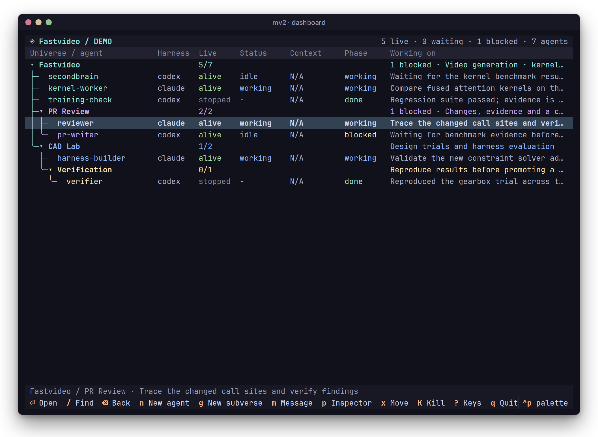

# Dashboard reference

Every dashboard key, column and view setting is listed here. For a quick start, see the [dashboard](../use/dashboard.md) page.

```sh
mv2              # the current universe, created if there is none
mv2 tui          # the current universe
mv2 -u .multiverse/subverses/review tui
```



## Layout

- **The list** is one tree. The universe and each subverse are folders, with their agents underneath. Folders fold and unfold. Marks follow an agent's name: `●` waiting for you, `⚠` a damaged record, `◉` focused, and its unread count where the view shows it. A name too long for its column is shortened, never its marks.
- **The header** counts live agents, agents waiting for you (an orange `●` marks them) and focused agents (a `◉` marks them). For Claude agents with a live connection, it also shows your account's rate-limit windows, such as `5h 34% · 7d 12%`. `mv2 changed: reopen` appears when mv2's own code changed on disk after the dashboard started (see [troubleshooting](../use/troubleshooting.md#the-dashboard-says-mv2-changed)).
- **The inspector** (`p`) shows the selected agent's work, harness and model, state, and a live view of its terminal. The live view leaves out the harness's input box, with any text typed in it, and the rows under it: Claude's status line, permission mode, tips and notices such as an installed update, and Codex's footer. A dialog in place of the input box, such as a permission prompt, stays, and so does a screen with nothing but the input box on it. `mv2 inspect` keeps every row. A dormant agent has no terminal, so the inspector shows none and offers `r` to resume it; `v` shows why it is dormant. When the agent has unread inbox messages, the inspector says how many. When something is wrong, the reason comes right after the agent's name: an unusable record (with its file), a failed launch, a lost connection, the reason a launch fell back to plain, or a `Plugins:` line with the plugins the launch left out and any it started with less. The fallback reason is the harness's own; what the plugins did is on the `Plugins:` line. For a folder, it shows counts and recent work. It sits on the right in wide terminals and below the list in narrow ones. `v` lists the same launch mode, fallback reason and plugins.
- **The bottom line** shows key hints and the result of your last action. The hints are clickable.

In a narrow terminal, the optional columns are hidden first. The whole tree fits in 60×20. The dashboard respects `NO_COLOR`.

## Columns

| Column | Shows |
| --- | --- |
| `name` | The agent's name (always shown) |
| `live` | `alive`, `ending`, `stopped`, `dormant`, `starting` (a new agent still being prepared) or `unknown` |
| `status` | `working`, `waiting`, `idle` or `disconnected`, from the harness over a live connection |
| `context` | The latest request's size against the model's window, such as `82k/200k`. It turns yellow at 70% and red at 90%. It shows `…` until the agent's usage has been read, which can take a few seconds after the dashboard opens; the agents are listed before then. An agent whose conversation can't be confirmed shows `N/A`, never an earlier reading |
| `cost` | The session's cost so far (off by default), or `…` until it has been read |
| `phase`, `summary` | What the agent last reported with `mv2 report`. A `working` or `blocked` phase also says how long ago it was reported, so how current the summary is, such as `working (10m)` or `blocked (2h)` |
| `focus` | How long the agent's focus lasts: the time left, `turn` or `on` (off by default) |
| `harness` | The harness the agent runs |
| `model` | The agent's model by its display name, such as `Opus 5.5` or `GPT 6.1 Sol`: the universe's own name for it from its harness settings, else the one mv2 ships in its model tables (which follow new releases, so an alias such as `opus` can later name a newer model). A model neither names shows as recorded, and an agent spawned without one shows `-` (off by default) |
| `effort` | Not a column of its own: with `model` also listed, the agent's effort in parentheses in the Model cell, such as `Opus 5.5 (xhigh)`; nothing when none was chosen. Without `model` it shows nowhere (off by default) |
| `id`, `universe`, `task`, `updated_at` | Optional extra columns |
| `unread` | Not a column of its own: the agent's unread inbox messages as a count after its name, such as `reviewer ✉2`, shown only while there are some (off by default). Counting them never marks them read, and an inbox that can't be read shows no count |
| `blocked_on` | Not a column of its own: a blocked agent's summary starts with what it's waiting for, in its own colour, such as `Waiting for user: decide the model list`, `Waiting for tester in qa: …` or `Waiting for self: tests running, ETA 5 min`, or just `Waiting for lifecycle` with no summary (on in both bundled templates). An agent mv2 can no longer find reads `Waiting for ada (gone)`, and one named `user` or `self` reads `agent user`. A view without `summary` (or `core:summary`) shows it nowhere, the inspector included; a plugin column standing in for Summary shows its own value, and core's summary where it has none |

Choose columns in the universe's `views/default.json` (see [views](#views)). [Concepts](../concepts.md#agent-state) explains the state fields.

Plugins can add columns. Name one in `columns` by its key, or as `PLUGIN:KEY`. A plugin's column can also stand in for a core column. Where the view lists that core key, such as `context`, and the plugin is on, the dashboard shows the plugin's column there, and a row the plugin has no value for shows core's cell. To keep core's own column, list it as `core:context`, set `"replace": false` in the view, or name the plugin's column to place it yourself. Name, Live, Status and Focus always show core's own. The Plugins screen says when a plugin's column replaces a core one.

## Keys

| Key | Action |
| --- | --- |
| `↑`/`↓` or `k`/`j` | Select a row |
| `←`/`h`, `→`/`l` | Fold, or go to the parent; expand, or go to the first child |
| `Space` | Fold or expand the selected folder |
| `Enter` | Attach to a live agent; enter a subverse |
| `Backspace` | Return to the previous universe |
| `/`, `Esc` | Search every folder, including folded ones; clear the search |
| `n` | Create an agent in the selected folder |
| `g` | Create a subverse in the selected folder |
| `m` | Message the selected agent |
| `f` | Focus the selected agent, or unfocus it |
| `K` or `s` | Kill the selected agent, after confirming |
| `r` | Resume a stopped or dormant agent |
| `p` | Show or hide the inspector |
| `v` | Show full details of an agent or folder |
| `i` | Read the selected agent's unread inbox messages; they stay unread for the agent |
| `a` | Answer the prompt a waiting agent is stopped at: a permission prompt, a question or a plan |
| `x` | Move the selected agent or subverse |
| `d` | Send the selected agent or subverse to the trash, after confirming |
| `P` | Open the selected universe's plugins: turn each on or off (choosing its access when it can work with less than it asks for), see what it adds and its access, and Configure it; see [plugins](../use/plugins.md) |
| `Tab` | Move between the list, a local view and its links |
| `F5` | Refresh now |
| `?` | Show all keys |
| `Ctrl-p` | Open the command palette, including plugins' actions |
| `q` | Quit. Agents keep running |

In forms, `Tab` and `Shift-Tab` move between fields, `Ctrl+Enter` submits and `Esc` cancels.

**Mouse:** click a folder to fold it, and double-click it to enter it. Click an agent to select it, and double-click it to attach. Click the breadcrumb to go back.

## Create agents and subverses

Press `n` to add a draft row in the selected folder. Type the name, then press `Tab` to choose a harness with `↑`/`↓`. Press `Tab` again for the model. A harness with a model list (Claude and Codex) offers it to choose from with `↑`/`↓`. Without a narrowed list in the universe's harness settings you can also type any model ID; with one, only its models are offered. `default` leaves the choice to the harness, and is offered only where the settings allow that. Where the harness settings name the model (`settings.model`), `default` says which, such as `default (Sonnet 5.5)`, and its efforts are offered as for that model. Where the chosen model takes an effort, `Tab` again chooses one the same way. For a harness without a list, type the model, or leave it empty for the harness's default. `mv2 spawn` checks the choice, and its reason shows on the status line if it refuses.

`Enter` creates the agent, and `Esc` discards the draft. The draft has no field for a first prompt, so the new agent goes `idle` once it has started. Send it a message with `m`. An agent created with a prompt (`mv2 spawn --task`) is `working` until it finishes that prompt, then `idle`.

`status` and `phase` are separate. `status` is the harness's own state (`working`, `waiting` or `idle`). `phase` is what the agent last reported with `mv2 report`, and reads `starting` until it reports.

Press `g` for a new subverse, type a name and press `Enter`. The subverse uses its parent's workspace and the `base` template. For anything else, use `mv2 subverse` (see [universes](../cli/universes.md#subverses)).

## Message, focus, kill and resume

- **`m`** opens a message form for the selected agent. A stopped agent is resumed with your message as its first prompt. On a focused agent, the message goes to its inbox without interrupting it; to answer it, attach with Enter. If the agent focuses while the form is open, your message goes to its inbox.
- **`f`** asks how long to [focus](../cli/messaging.md#focus-an-agent) the selected agent: 5 minutes, 20 minutes, 1 hour, until its next turn ends, or until you unfocus it. The turn choice shows only while the harness reports the agent's status. On a focused agent, `f` unfocuses it and says how many inbox messages wait. The inspector and `v` say until when an agent is focused.
- **`i`** shows the selected agent's unread inbox messages as the agent will read them with `mv2 inbox`. Reading them here doesn't mark them read, so the agent still gets them.
- **`a`** answers the prompt a `waiting` agent is stopped at, as [`mv2 answer`](../cli/waiting-prompts.md) does. The inspector names the prompt (`⏸ Waiting on: permission · Bash: git push`). `a` opens it with the call and the choices the harness offers, or its questions. A choice that saves a rule to your settings is marked. A form with both questions and choices, such as Codex's cancel, takes one or the other: its answers, or a choice you pick instead, which goes alone; `Enter` on the picked choice again takes it back. A question that takes a note, such as Codex's "Other", has a note box beside it. A secret answer or note is typed into a hidden box. Nothing counts until you pick it: a choice with `Enter`, an option with `Space`. `Ctrl+Enter` answers and `Esc` closes without sending. The outcome, and why when the answer didn't take, shows on the bottom line and in the inspector as `Last answer`. A prompt takes one answer, so mv2 never sends a second one.
- **`K`** asks for confirmation, then kills the agent. Its record and conversation are kept.
- **`r`** resumes it.

The bottom line shows each result, such as `worker has your message for its next turn.` [Messaging](../cli/messaging.md#read-the-result) explains each one.

**A damaged record.** An agent whose record file cannot be read shows as a row marked `⚠`, with `live` and `status` `unknown`. Its summary and the inspector name the file and the reason. The other agents are not affected, and the row recovers on the next refresh once the file is repaired or restored. Message, resume, move, delete and attach refuse such a row and say why. `K` does the same, except for an agent whose `runtime.json` is missing: `K` then asks for confirmation and finds the agent's tagged terminal to stop it. A folder with no agent record at all, only leftover files, shows as a leftover folder, and the inspector says what to do: `d` checks that no terminal is running for it, then moves the folder to the trash. For an agent whose `runtime.json` is missing, the inspector points to `K`. The [agents guide](../cli/agents.md#damaged-records) covers the same records from the CLI.

## Move and delete

Press `x` on an agent or subverse to pick it up. Move to the destination folder and press `Enter` or `x` to drop it there, or press `Esc` to cancel. Press `d` to send it to the trash; the confirmation says what will go. Neither works on running agents, so stop them first.

## Attach and detach

`Enter` on a live agent attaches to its terminal. `Ctrl-b d` detaches and returns you to the dashboard, with your selection where you left it. This works even when the dashboard itself runs inside tmux. Custom tmux prefixes and bindings are kept.

For a Codex agent, the mouse wheel scrolls its transcript. For keyboard scrollback in any agent, press `Ctrl-b [` and then use Page Up and Page Down. Press `q` to leave scrollback.

## Subverse portals

`Enter` on a subverse opens it as its own view. Its title, columns and widgets replace the parent's. `Backspace` or the breadcrumb takes you back, and restores folds, selection, search and scroll. You can't go above the universe the dashboard was opened on.

## Views

Each universe can style its folder and its portal in `views/default.json`:

```json
{
  "title": "Review",
  "accent": "#cba6f7",
  "columns": ["name", "live", "status", "phase", "summary"],
  "widgets": [
    {"type": "markdown", "title": "Scope", "text": "**Goal:** review the login change."},
    {"type": "table", "title": "Findings", "columns": ["ID", "Status"], "rows": [["F-1", "open"]]},
    {"type": "artifacts", "title": "Evidence", "items": [{"label": "Test log", "path": "artifacts/test.log"}]}
  ]
}
```

| Field | Meaning |
| --- | --- |
| `title` | The folder and portal title |
| `accent` | A hex color, or `auto` to pick one from the universe's ID |
| `columns` | Agent columns, in order. The top universe's choice applies to the whole tree. `unread` adds each agent's unread inbox count to its name, `blocked_on` what a blocked agent waits on to its summary, and `effort` an agent's effort to its Model cell, instead of a column each. Both bundled templates turn `blocked_on` on. `Silicon23` also turns on `unread`, `model` and `effort`, in place of `harness`, and leaves `context` out; `base` leaves those off and shows `context` |
| `replace` | `false` keeps every core column core's own, even where a plugin's column would stand in for it. The default is `true` |
| `widgets` | Optional panels in this universe's portal: `markdown` (`title`, `text`), `table` (`title`, `columns`, `rows`) and `artifacts` (`title`, `items` with `label`, `path`, optional `description`) |

Artifact paths are relative to the universe directory and must stay inside it. Text and Markdown files preview in the dashboard. Other files open in your system's viewer when you choose the link.

Views never run commands. A widget with a mistake shows an error in its place, and the rest of the view still works.

The limits are 32 widgets, 16 table columns, 500 rows, 100 artifacts per widget, and 32 KiB of Markdown per block.
