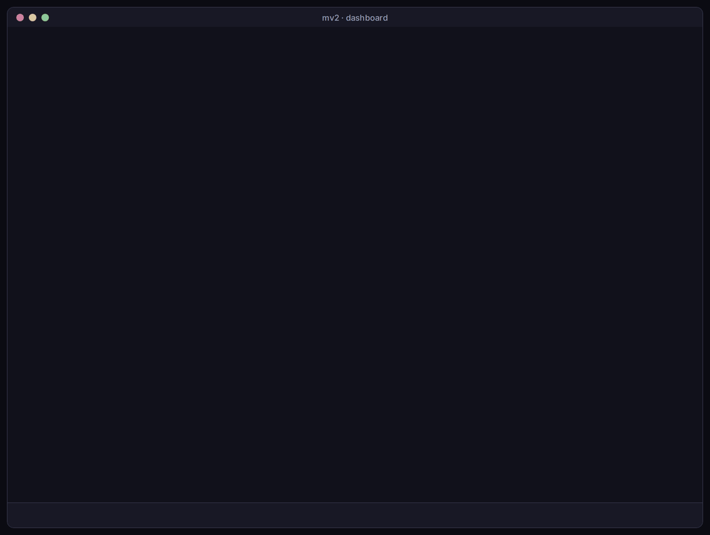
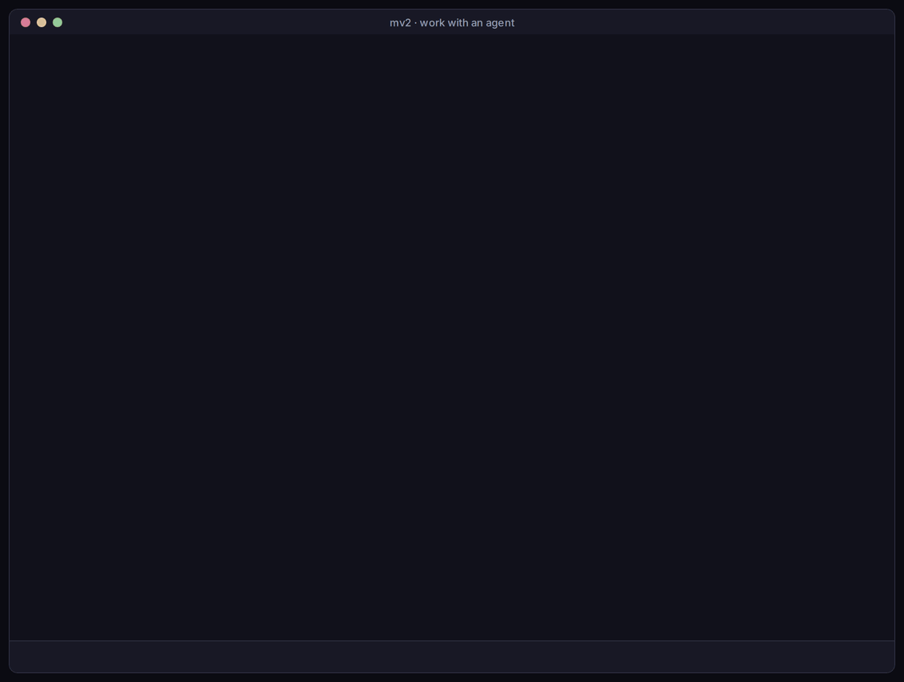
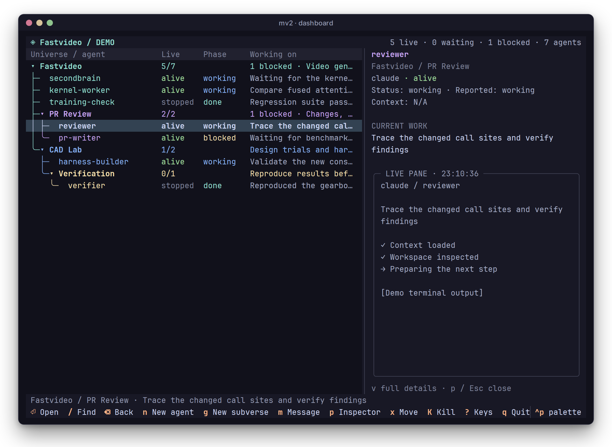
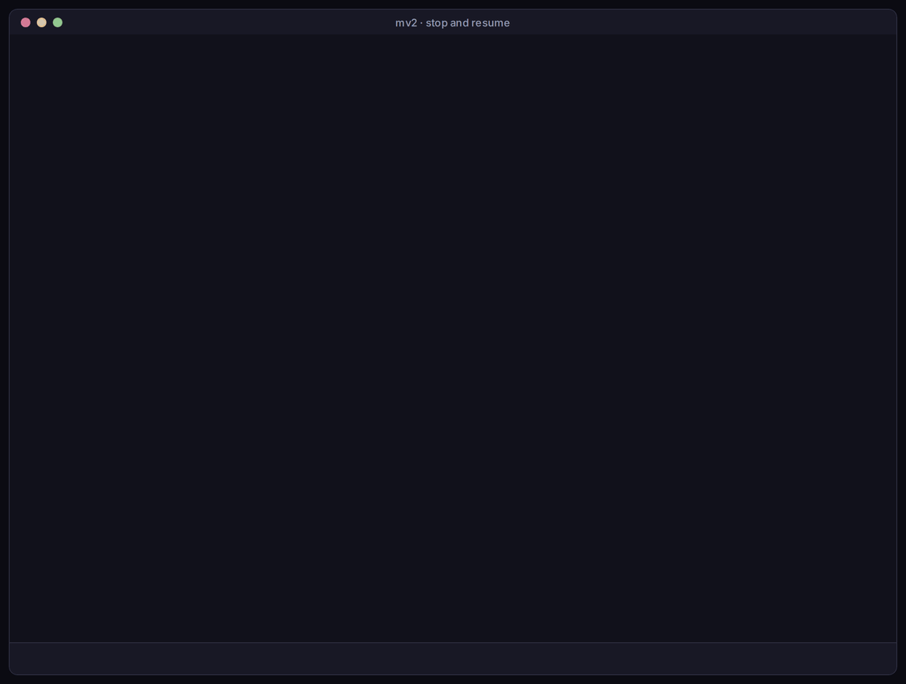
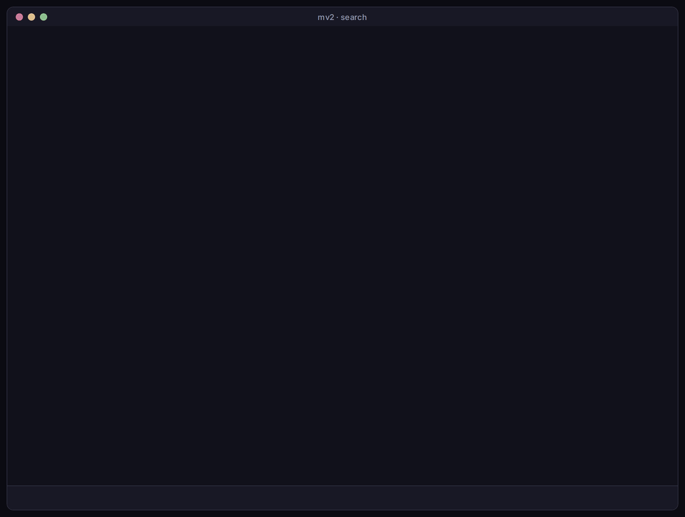
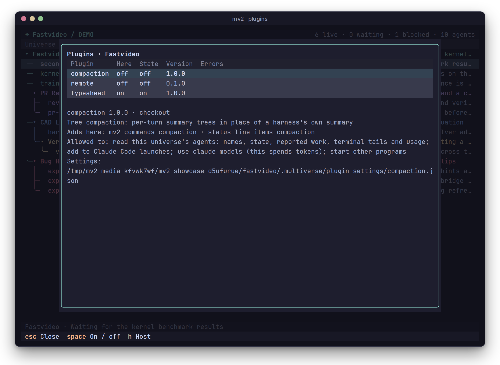

# Dashboard

The dashboard lists every agent in your project, shows what each one is doing, and opens any agent's terminal so you can work with it. Run `mv2` in your project to open it:

```sh
mv2
```



Quitting with `q` leaves every agent running, and the dashboard shows the same state when you open it again.

## Keys you will use most

| Key | Does |
| --- | --- |
| `n` | Start an agent in the selected folder |
| `Enter` | Open the selected agent's terminal, or open a subverse |
| `Ctrl-b d` | Leave an agent's terminal and return here |
| `p` | Show or hide the inspector: the selected agent's work and live terminal |
| `K`, `r` | Stop the selected agent; resume it |
| `g` | Make a subverse in the selected folder |
| `x` | Move the selected agent or subverse, then `Enter` on the destination |
| `/` | Search all agents and folders |
| `P` | Plugins for the selected universe |
| `?` | Every key |

The [dashboard reference](../reference/dashboard.md) lists every key and column, and explains how to customize a view.

## Start an agent

Select a folder and press `n`. Type a name, press `Tab` to choose a harness, and press `Enter`. The agent shows as `starting`, then `working`.


## Work with an agent

Press `Enter` on an agent to open its terminal. It is the agent's normal Claude Code, Codex or Pi screen, so type to it as you usually would. Press `Ctrl-b d` to come back; the agent keeps working.



You don't need to attach to keep an eye on agents. Each row shows the agent's state and what it last reported, and `p` opens the inspector with the selected agent's live terminal.



## Stop and resume

Press `K` and confirm with `Ctrl+Enter` to stop an agent. Its conversation is kept, so `r` resumes it where it stopped.



## Organize with subverses

A subverse is a folder of agents with its own setup. Press `g` to make one, then `x` on a stopped agent and `Enter` on the subverse to move the agent in. `Enter` on a subverse opens it as its own view, and `Backspace` goes back. [Subverses](subverses.md) walks through a complete example.


## Search

Press `/` and type. The search covers every folder, including folded ones; `Esc` clears it.



## Plugins

`P` lists the plugins for the selected universe, which ones are on, and what each adds. Select one and choose **Configure** to change its settings. See [plugins](plugins.md).


