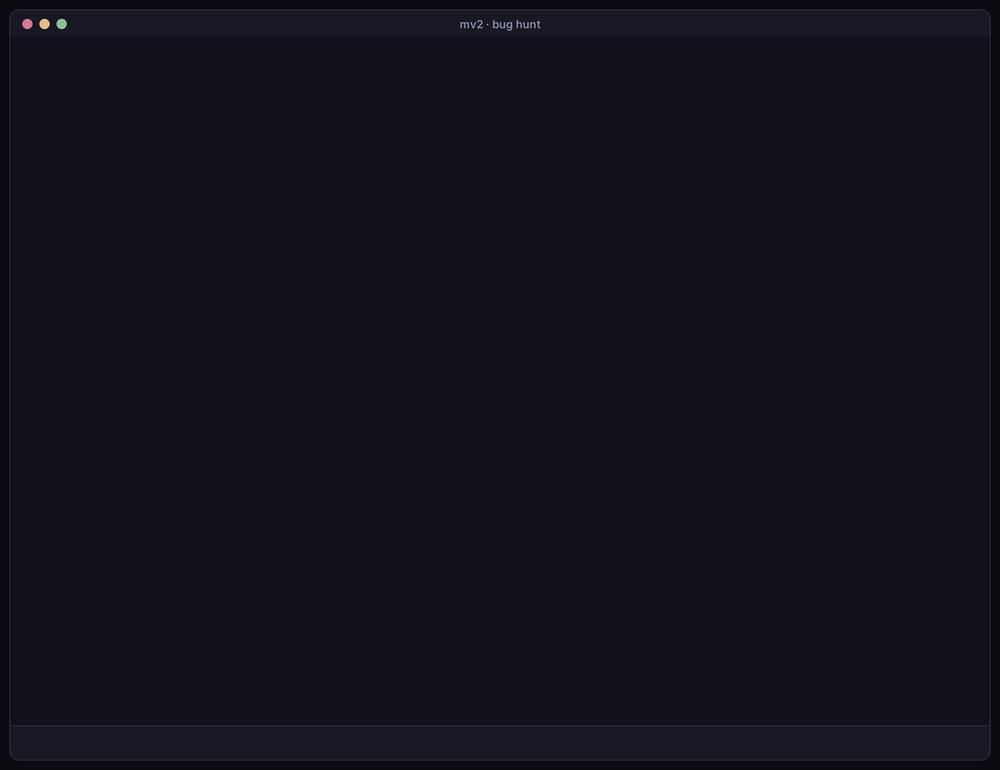
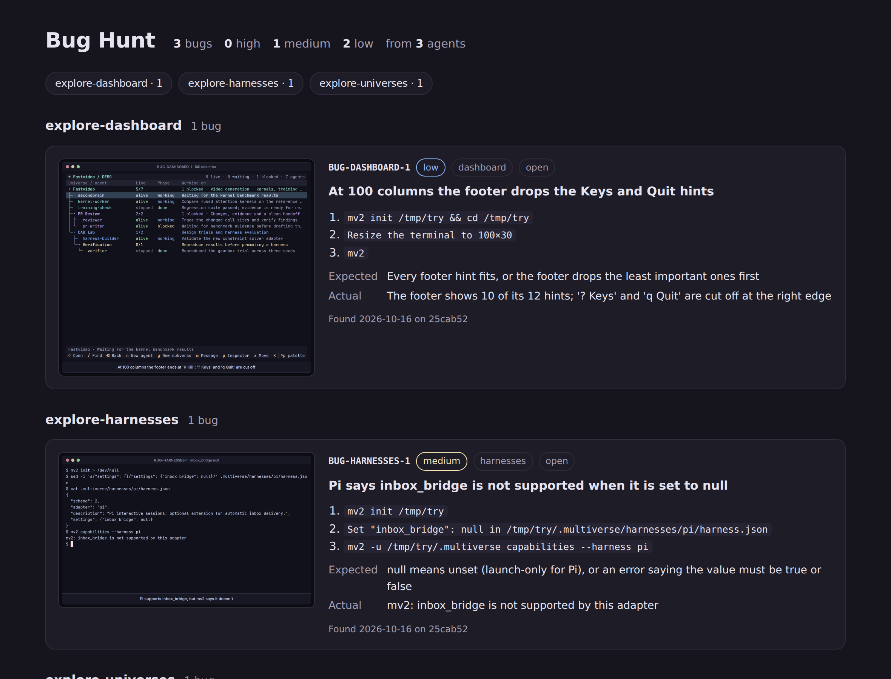
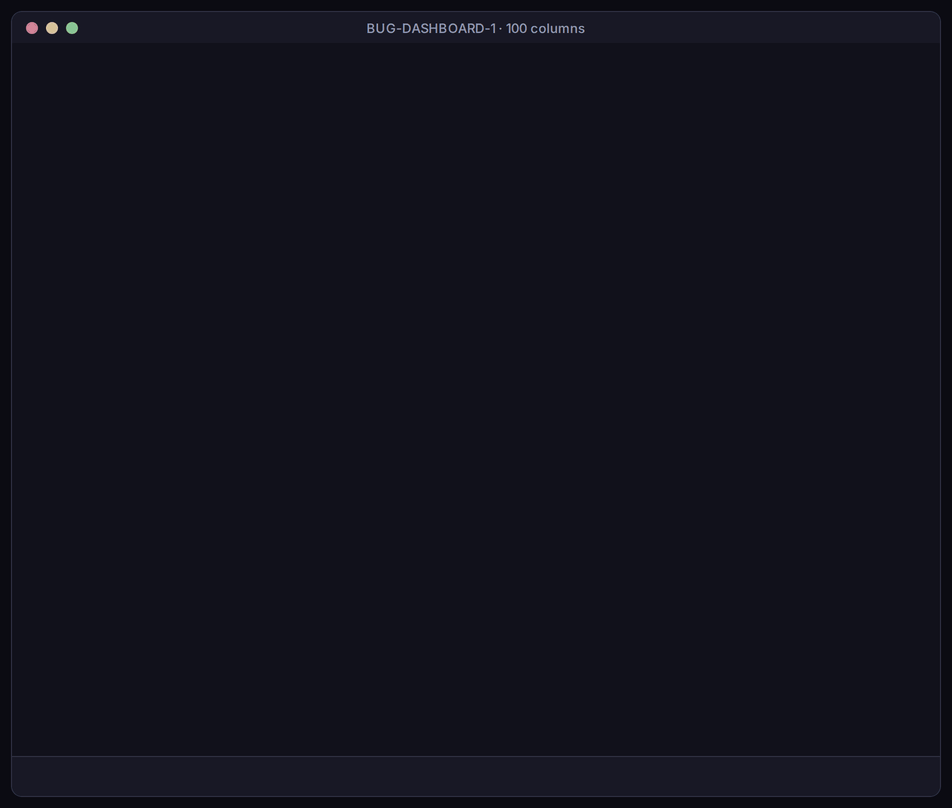

# Subverses

A subverse is a folder of agents with its own setup. It has its own instructions, harness settings and dashboard view, and it can have its own working directory. Use one for each team or job, such as a review crew, a test department or an experiment. Each group's agents and instructions then stay apart.

## Make one in the dashboard

1. Select the folder it should go in and press `g`.
2. Type a name and press `Enter`.
3. To move an agent in, press `x` on the agent and `Enter` on the new folder.

Press `Enter` on the subverse to open it as its own view, and `Backspace` to go back.


A subverse made this way uses the `base` setup. To start from a different one, make it from a template.

## Example: a bug hunt

This example sets up a subverse where agents explore mv2 and file each bug with a short clip of it happening. They also keep a page of everything they found. It only edits the subverse's own files.

### 1. Make the subverse and tell its agents what to do

```sh
mv2 subverse bug-hunt
```

This makes `.multiverse/subverses/bug-hunt/` with the base setup. Replace its `bootstrap.md`, which every agent here reads at each start and resume:

```markdown
You hunt bugs in mv2; you never fix them. Work in a scratch universe: `mv2 init "$(mktemp -d)"`.
For each bug, write `artifacts/bugs/BUG-AREA-N.json` with steps, expected and actual, save a clip
of at most 15 seconds next to it, and add the bug to `artifacts/bugs.html` and to the Bugs table in
`views/default.json`. Then run `mv2 report --phase working --summary 'Filed BUG-AREA-N'`.
```

Add a workflow for the agent that leads the hunt, in `workflows/hunt-lead/`:

| File | Content |
| --- | --- |
| `entry.json` | `{"description": "Split mv2 into areas and start one explorer per area."}` |
| `prompt.md` | The areas to cover, and how to start an explorer for each: `mv2 spawn --name explore-AREA --task "Hunt bugs in AREA."` |

### 2. Give it a view

`views/default.json` sets what the subverse shows when you open it: a short brief, the bug table the agents fill, and a link to their page.

```json
{
  "title": "Bug Hunt",
  "accent": "#f38ba8",
  "columns": ["name", "live", "phase", "summary"],
  "widgets": [
    {"type": "markdown", "title": "How this hunt works", "text": "Each explorer takes one area and files bugs in `artifacts/bugs/`."},
    {"type": "table", "title": "Bugs", "columns": ["ID", "Severity", "Agent", "Title"], "rows": []},
    {"type": "artifacts", "title": "Hunt files", "items": [{"label": "Bug dashboard", "path": "artifacts/bugs.html"}]}
  ]
}
```

The [dashboard reference](../reference/dashboard.md#views) lists every widget.

### 3. Start the hunt

Open the dashboard and select the `Bug Hunt` folder. Press `n` to start a lead agent, then attach to it and ask:

```text
Run the hunt-lead workflow. Cover the dashboard, harnesses and universes areas.
```

The lead starts one explorer per area. Each explorer works in a scratch universe of its own, so it never disturbs your real agents. When an explorer finds a bug, it writes a report, records a short clip of it, and updates the bug table and page.

A hunt spends model tokens for every explorer, so start with two or three areas.

### 4. See what they found

Open the subverse with `Enter`. Its view shows each explorer's phase and summary, the bug table, and links to the files:



`Bug dashboard` opens `artifacts/bugs.html` in your browser. In this run, the agents grouped every bug by the agent that found it, with each bug's steps and clip:



This is one of the clips an explorer recorded. It shows that at 100 columns, the dashboard's footer cuts off its last hints:



The results shown here come from a sample run. The three bugs in it are real.

## Point a subverse at another directory

Agents in a subverse start in its parent's project directory unless you give it another one, such as a Git worktree:

```sh
git worktree add ../feature-x -b feature-x
mv2 subverse feature-x --workspace ../feature-x
```

mv2 doesn't create the worktree, so make it first.

## Make your own template

Copy the bundled template in `src/multiverse/templates/base/`, then change its bootstrap, workflows and view. A setup like the bug hunt above makes a good template once it works. Keep personal templates in `~/.multiverse/templates/NAME`, and use them by name with `mv2 subverse NAME --template NAME`. [Templates](../develop/templates.md) explains every file.

## Views

Each subverse can show its own panels when you open it, such as a Markdown brief, tables and links to files. You set them in the subverse's `views/default.json`. The bug table above is one of these panels. The [dashboard reference](../reference/dashboard.md#views) lists every field.
